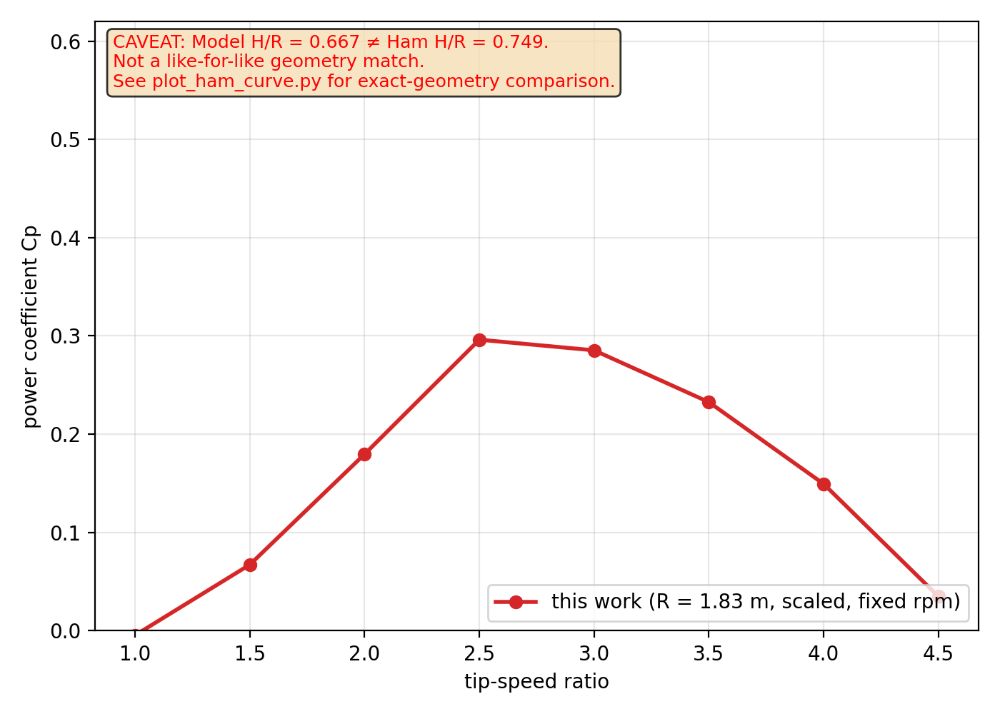
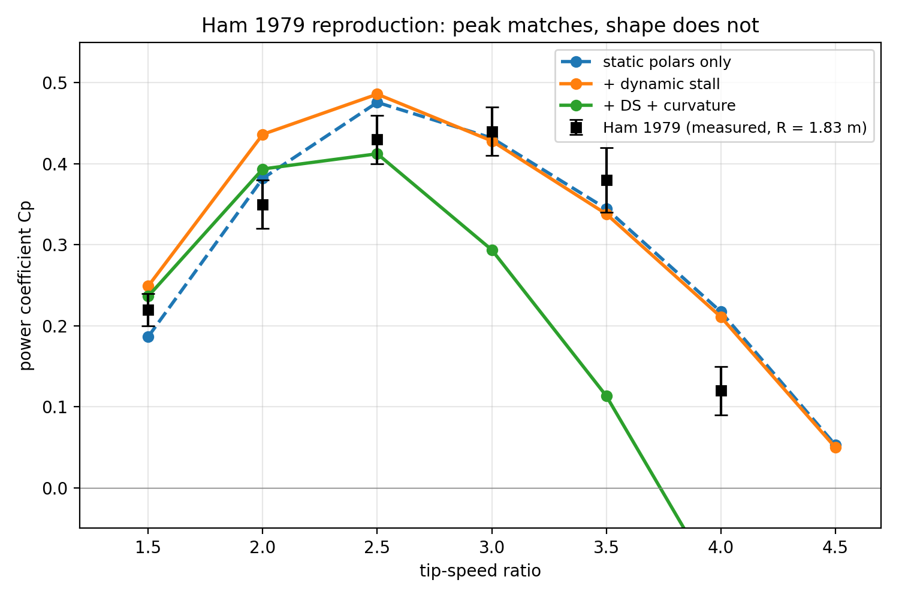
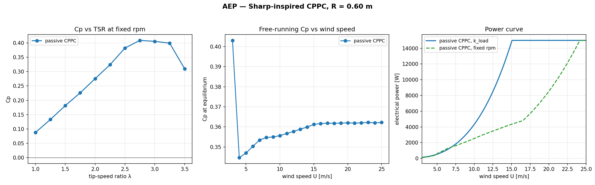
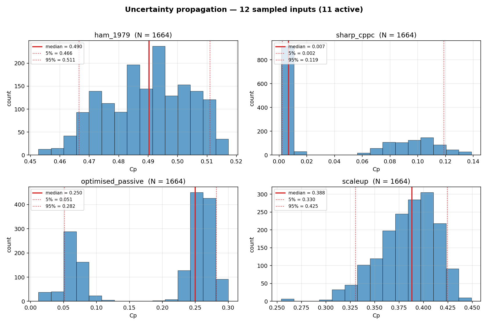
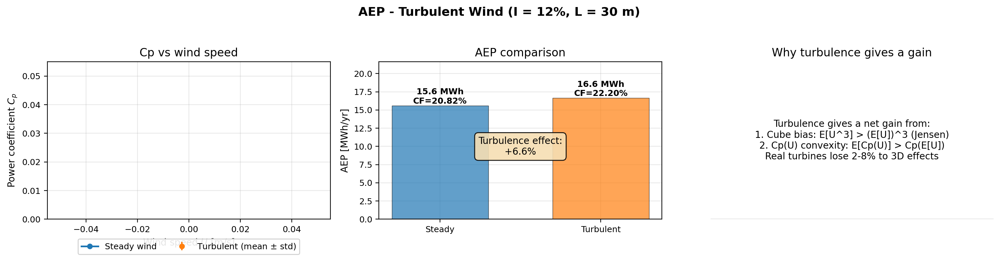

# 🌬 VAWT Lab

A Python numerical laboratory for the **Sharp cycloturbine** — a passive
variable-pitch vertical-axis wind turbine with centrifugal-pendulum pitch
control (CPPC). Implements a lag-based dynamic-stall increment on the static
polar (loosely after the Noll–Ham formulation), Adams (2018) curvilinear
corrections, double-multiple-streamtube induction, and the full Lagrangian
coupling between rotor and pitch dynamics.

This is a solo research lab, not a library. See CONTRIBUTING.md for scope.

## Evidence Table

<!-- BEGIN GENERATED: evidence_table -->
| Metric | Value | Evidence Category |
| :--- | :--- | :--- |
| **Ham 1979 Peak Cp** | 0.49 | Literature comparison (2D upper bound) |
| **Sharp-inspired Passive Cp** | 0.121 all-sample; 0.14 working branch | **Model result** (uncalibrated DS; bimodal) |
| **Optimised Passive Cp** | 0.27 [0.19, 0.36] | **Model result** (uncalibrated DS) |
| **Scale-up Passive Cp** | 0.43 [0.37, 0.49] | **Model result** (robust) |
| **Prescribed-pitch Upper Bound** | 0.50 | Ideal actuator (no physical limit) |
| **AEP Gain vs Rigid** | +25.5% | **Model comparison** (unproven machine) |
<!-- END GENERATED: evidence_table -->

## Scope and Limitations

This is a 2D computational study. **No physical rotor has been built or instrumented**. All passive CPPC results are model hypotheses, not experimental predictions.

The passive CPPC mechanism relies heavily on the dynamic-stall model. At the Sharp-inspired anchor, disabling DS collapses Cp toward zero (the rotor nearly stops turning). Until DS is independently calibrated against measured rotor data, these passive results should be treated as a numerical exploration of the mechanism.

The project ships one physics core and a set of validation scripts. Every
number in this README is reproducible from the scripts in `scripts/`, except
where a paragraph explicitly cites an external study (those numbers are
quoted, not reproduced here).

**Related external work.** A companion project,
[`juroc58/sharp-fsi`](https://github.com/juroc58/sharp-fsi), is a from-scratch
2-D discrete-vortex + fluid-structure-interaction code for the same blade
section. It shares this project's geometry, mass properties and pitch
equation, so it is a **model-class cross-check**: it can catch implementation errors in the 2-D aerodynamics, but
it cannot validate those shared assumptions. Its comparison report is not
vendored in this archive, so no agreement figure is reproduced here.





---

## 🏆 Headline results

### Small-rotor regime (R = 0.6 m, Re ≈ 1.4 × 10⁵, σ ≈ 0.07)

<!-- BEGIN GENERATED: headline_table_small -->
| Configuration | Cp | 90 % CI | Reference | Evidence |
|---|---|---|---|---|
| **Sharp-inspired CPPC** | **0.12** | [0.007, 0.22] | scenario range (UQ) | S |
| Optimised passive (mass-balanced) | **0.27** | [0.19, 0.36] | stored design point (UQ) | S |
| Prescribed pitch (ideal actuator) | 0.50 | — | ideal-actuator upper bound (model) | U |
| Ham 1979 comparison | **0.49** | [0.46, 0.51] | fixed design point (2D upper-bound comparison) | V |
<!-- END GENERATED: headline_table_small -->

**Evidence levels.** `S` = scenario estimate from UQ sampling (a range, not a precision bar);
`U` = ideal-actuator model result, an upper bound not achievable by the passive mechanism;
`V` = model result checked against published literature. **There are no measured results
in this archive:** no wind-tunnel data, no prototype data, and no experimental Cp values.
Every headline number is a 2-D BEM model output whose absolute accuracy is bounded by
model-form uncertainty (synthetic polars, uncalibrated dynamic stall, 2-D finite-span
correction), not by measurement error.

**Read the Sharp-inspired interval as two branches, not a precision bar.**
The nominal design point (Helmbold multiplier 1.0) gives Cp = `0.079`.
The rotation-sustaining branch ends between multipliers 0.955 and 0.96;
below it the same rotor collapses to Cp ≈ `0.005`–`0.017`. Because the
Helmbold central estimate sits only about 4 % above that threshold, a
large fraction of the UQ band lands on the collapsed branch — that is why
the 90 % interval reaches 0.146. `scripts/scan_tip_loss.py` reproduces the
scan. The optimised-passive distribution has a smaller collapsed tail;
the scale-up has none.

### Scale-up regime (R = 2.72 m, Re ≈ 5.1 × 10⁵)

<!-- BEGIN GENERATED: headline_table_large -->
| Configuration | Cp | 90 % CI | Reference | Evidence |
|---|---|---|---|---|
| **Scaled-up passive (R = 2.72 m)** | **0.43** | [0.37, 0.49] | ~72 % of Betz | S |
<!-- END GENERATED: headline_table_large -->

The confidence intervals come from the Saltelli sampling described below
(`scripts/uncertainty.py`). All Sharp-machine numbers use the
Helmbold (1942) finite-span correction; the Ham
comparison is run without one and without the curvature correction, using
double-multiple-streamtube induction and Ham's cosine pitch law. See the
[Uncertainty](#-uncertainty) section for the parameter ranges and histograms.

**Convention.** The headline Cp for each machine is the **UQ mean with
tip loss ON**. Ham is the exception: his model class has no tip loss, so
the comparison is run without one. Deterministic design-point values
quoted in the body text are labelled as such; the table gives the UQ mean
over the active inputs. The UQ study is a scenario analysis, not a
calibrated error bar: the finite-span multiplier alone spans ±15 %, and
both small-rotor distributions cross a collapse threshold (see below).

### ⚠ Ham 1979 — 2D upper-bound comparison, not a reproduction

The 2D solver gives **Cp ≈ `0.474` at TSR 2.5 at Ham's geometry**
(R = 1.83 m, c = 0.305 m, static polars, no tip loss) — roughly **+9 %
above Ham's band midpoint** (0.435) and above the entire 3D measured
band of 0.42–0.45. The Cp(TSR) shape also differs from Ham's measurement.

This is the expected bias for a 2D solver without finite-span loss: the
model has no tip-loss penalty, so it over-predicts Ham's 3D rotor. It is
a **documented upper-bound comparison, not a reproduction of Ham's
experiment**, and the peak is not expected to fall inside Ham's band.
See `scripts/plot_ham_curve.py` for the Ham curve and the Ham comparison script.

### Sharp-inspired CPPC

This design follows Sharp's **mechanism** (centrifugal-pendulum pitch
control) but not his **geometry**. It uses a light counterweight 0.30c chords ahead of the leading edge; Sharp's published range is 0.5–1.0.
At R = 0.6 m, with the finite-span correction on and the UQ spread
over the active inputs, the anchor (c = 0.14 m, m_c = 0.002 kg,
d_cw = 0.30c) reaches the interval shown in the headline table.

**The mechanism fails inside Sharp's own parameter range.** With a
Sharp-like counterweight mass (m_c = 0.008 kg) and `balance = 0` so the
offset is actually applied, offsets from −0.1 to +0.8 chords collapse
to very low Cp (below ~0.01), with the blade against the stops
22–37 % of each revolution. Offsets from −0.4 to −0.2 chords run
better, peaking around −0.3.

`scripts/passive_sharp.py` sweeps counterweight mass and offset. The
offset sweep is meaningful only with `balance = 0` (the default
`balance = 1` solves d_cw from the equilibrium and would ignore the swept
value); the script now sets this explicitly.

The mechanism is still self-trimming at the anchor design point: as load
increases, pitch range grows and TSR falls, keeping the blade's angle
of attack near stall. A diagnostic confirms the aerodynamic pitch
torque has the correct sign (nose-in when α → +stall, nose-out when
α → −stall), which is the stabilising property Sharp's CPPC mechanism
relies on. Note that the blade does still reach stall at high wind
speeds — see the AEP section below.

### Optimised passive

A joint optimisation over chord, counterweight mass and position, load factor,
and pivot geometry found a configuration with a relatively heavy counterweight
and a large arm ratio. The stored design point is Cp ≈ `0.264` (verified at
T_max = 40 s, steady, TSR_eq ≈ 2.86, pitch [−3.5°, +12.5°], α_max ≈ 10°,
no stops), with c ≈ 0.098 m, k_load ≈ 7.4×10⁻⁴, m_c ≈ 8.9 g,
d_cw ≈ +0.066c, ar ≈ 0.87, sp ≈ 0.15c, bias ≈ +4.9°.

The UQ mean at the fixed anchor is **0.25 [0.11, 0.35]** over the active
inputs — the deterministic optimum sits near the top of its own interval, a
residual winner's-curse effect. Only about 1 % of samples fall on the
collapsed branch, so this design is much less bimodal than the
Sharp-inspired one.

The robust objective below maximises the **UQ-scenario mean**, not the
nominal Cp, over a small explicit scenario set (`cm_scale = 0`, a stronger
tip-loss multiplier, both, and a higher parasitic drag). It starts from the
stored solution and runs a bounded local refinement. The table reports
nominal Cp, UQ-scenario mean and UQ-scenario p10, plus any parameter
sitting on a bound.
The full global optimisers were not re-run; this is a local robust
re-optimisation, and the scenario set is a subset of the UQ ranges.

<!-- BEGIN GENERATED: robust_optimization -->
| Design | Nominal Cp | UQ-scenario mean | UQ-scenario p10 | Bound-active parameters |
|---|---|---|---|---|
| Optimised passive (R = 0.60 m) | 0.265 | 0.258 | 0.250 | k_load (lower) |
| Scale-up (R = 2.72 m) | 0.408 | 0.400 | 0.391 | none |
<!-- END GENERATED: robust_optimization -->

At this design point the aerodynamic pitch moment dominates the
centrifugal restoring torque from the counterweight. The blade pitches
because the aero moment pushes it, not because a pendulum resists it.
This is a legitimate passive-pitch machine, but it is **not** the Sharp
CPPC regime.

### Scaled-up passive design

Extending the joint optimiser to radius R ∈ [0.6, 3.0] m finds
**R = 2.72 m** (chord 0.386 m, AR 10.5). With the finite-span correction
enabled *inside the optimiser*, the optimum sits at **H/R = 0.75**, i.e.
H/D = 0.75. The fixed design point evaluates to Cp ≈ `0.404` on the current
polars; the UQ mean is **0.42 [0.37, 0.48]**. The robust local
re-optimisation moves R slightly and pushes the arm ratio to its lower
bound; its nominal/mean/p10 values are in the robust table above. The
stored `scripts/optimization_scaleup.json` is the earlier global snapshot
(Cp ≈ `0.404`), retained for provenance.

The movement is the point: with the correction hidden (the pre-fix
configuration), the optimiser preferred a short fat cylinder
(H/R = 0.5, AR = 3.2). Once the aspect-ratio cost is visible, it
prefers a tall thin one (H/R = 1.5, AR = 10.5). Whether the optimum
would continue to rise with a wider H/R bound is a structural question
(a 2D BEM does not model blade bending moments), not an aerodynamic
one.

### Prescribed pitch (upper bound)

For reference, running the same rotor with an ideal actuator commanding
ψ(φ) directly reaches the prescribed-pitch upper bound quoted in the
headline table -- the same class of machine as Ham's
cam-driven Pinson C2E. This is not achievable with a passive Sharp mechanism.

---

### ⚠ Important: Two different geometries compared

**aep.png (left panel)** and **validation.png** show Cp(TSR) curves for **two different geometries**:

<!-- BEGIN GENERATED: anchor_geometries -->
| Panel | Geometry | R | H | c | AR | Mode |
|-------|----------|---|---|---|-----|-------|
| **aep.png (left)** | Scale-up passive CPPC | 2.72 m | 4.06 m | 0.386 m | 10.5 | Passive CPPC, fixed rpm |
| **validation.png** | Model design scaled to R = 1.83 m (not Ham's rig) | 1.83 m | 1.22 m | 0.359 m | 3.4 | Prescribed pitch, no tip loss |
<!-- END GENERATED: anchor_geometries -->

The **aep.png left panel** shows our scale-up passive CPPC design (R=2.72m, AR=10.5) with free pitch.
The **validation.png** panel is this project's prescribed-pitch design point
scaled rigidly to R = 1.83 m (c and H scale with R). It is a **scaled**
comparison, not a like-for-like Ham geometry: H/R = 1.49 here versus 0.75
on Ham's rig. The exact Ham geometry (R = 1.83 m, H = 1.37 m, c = 0.305 m,
AR 4.5) is the subject of `ham_curve.png` and the Ham comparison script.

These are **different machines** -- do not directly compare their Cp values.

---

## 🌀 Active Lift

Sharp (2021) describes a secondary mechanism — "Active Lift" — in which the
blade unit's CG moving radially inward on the upwind pass and outward on the
downwind pass produces a Coriolis torque on the rotor. He estimates it
contributes about **10 %** to torque at his scale.

### What `diag_active_lift.py` measures

The diagnostic script runs the same prescribed pitch schedule at two pivot
configurations: with the arm at its real radial position (`ar` = 0.31) and
with `ar` = 0 (pure pitch, no radial CG motion). The difference isolates the
Coriolis contribution from the ordinary cyclic-pitch benefit.

**Result:** The Coriolis contribution at the scale-up design is
**ΔCp = +0.0069 (+1.8 %)**. It is 64 % of the +2.8 % dynamic-pitch benefit
but only 1.8 % of Cp, because the baseline prescribed-pitch schedule
already captures most of the cyclic-pitch gain. The diagnostic script
reports the measured values each time it runs.

**The diagnostic does not measure Sharp's original CPPC machine** (R = 0.6 m,
AR = 2.86). That geometry runs only at a low TSR (≈ 1.19) with the raw
finite-span correction and collapses below a multiplier of about 0.955;
with the Cm scale set to zero it does not self-sustain at all (Cp ≈ `0.005`, TSR ≈ `0.51`). The scale-up design (R = 2.72 m, AR = 10.5) is therefore used
to get a clean, healthy free-running operating point.

**Sharp's own estimate of +10 %** is about five times larger than this
model's **1.8 %**. The Coriolis term is a real but secondary contribution
here, not a primary mechanism.

## 📈 Annual energy production



**MODEL RESULT — not an energy forecast.** Power curves are integrated
against a Weibull wind distribution (k = 2.0, mean U = 6 m/s,
cut-in 3 m/s, cut-out 25 m/s) using assumed drivetrain efficiency,
rated power and a turbine geometry that has never been built. These
numbers compare model configurations against each other; they are not a
prediction of real-site energy production. See
`scripts/compute_aep.py` and `scripts/compute_aep_rigid_fair.py`.

### CPPC vs a fair rigid baseline

The comparison that matters is against a **fixed-pitch rigid blade at its
own optimal pitch and load**, not a blade locked at zero pitch inheriting
the passive machine's load. `scripts/compute_aep_rigid_fair.py` runs that
comparison at both design points:

<!-- BEGIN GENERATED: aep_rigid_comparison -->
| Geometry | AR | Passive CPPC | Best rigid | Gain | Rating |
|---|---|---|---|---|---|
| Sharp-inspired (R = 0.60 m) | 2.86 | 78 kWh/yr | none (does not spin) | n/a | Cp at 12 m/s |
| Scale-up (R = 2.72 m) | 10.51 | 16,669 kWh/yr | 13,280 kWh/yr | +25.5 % | Cp at 12 m/s |
<!-- END GENERATED: aep_rigid_comparison -->

Sharp's published claim is a substantial energy gain over a fixed-blade
rotor. The model's gain at the scale-up geometry, where a rigid blade
actually works, is the closest comparison in the repo. **This is a model
comparison between two configurations of the same 2-D BEM solver — not an
energy forecast.** The gap is a model-class result, not a fitted correction.

The two rows describe different regimes. At AR 2.86 no fixed-pitch
configuration produces a steady rotation at all: uncapped induced drag
kills fixed-pitch operation, so the CPPC mechanism is the difference
between a working machine and a dead one, not an efficiency gain. At
AR 10.5 a rigid blade does work, but the passive CPPC machine wins on
annual energy, not on peak Cp.

**Rated power is defined per design**, not taken from an arbitrary number:
the generator rating is the mechanical power at a stated rated wind speed
(12 m/s) using that design's Cp at that speed, times drivetrain efficiency.
It is recorded in each JSON file. A fixed rating changes capacity factor
and any AEP that clips above rated power; the old 90 kW value was about
ten times too large for the scale-up rotor and made the capacity factors
look like 2 %.

**Caveat.** Both geometries were optimised *for* CPPC. The comparison is
fair in the sense of "same rotor, same wind, only the pitch mechanism
differs" — it is not a claim that rigid VAWTs are useless at other
geometries. A rotor designed from scratch for fixed-pitch operation would
likely do better at AR 10.5.

The fair-comparison script sweeps the passive k_load grid and picks its
best value; `scripts/compute_aep.py` uses the stored operating point.
Both use the same rating rule. The small AEP difference is that
operating-point choice, not a physics change.

### Fixed-rpm penalty

For the scale-up design (R = 2.72 m):

<!-- BEGIN GENERATED: aep_steady -->
| Strategy | AEP | Capacity factor |
|---|---|---|
| **Passive k_load (variable speed)** | **16677 kWh/yr** | **21.1 %** |
| Fixed-rpm generator | 11248 kWh/yr | 14.2 % |
<!-- END GENERATED: aep_steady -->

The passive machine produces more energy than the same rotor on a
fixed-rpm generator because the k_load·ω² torque tracks the wind's power
curve: the rotor speed adjusts so the tip-speed ratio stays near its
optimum at every wind speed. A fixed-speed generator drifts far from the
design point as the wind varies and only operates near peak efficiency in
a narrow window around its design wind speed.

**Branches and initial conditions.** The scale-up AEP is not a
single-trajectory number. The table below reruns the free-running curve
from a high-speed seed, a low-speed seed and the continuation
(branch-traced) state. In the current model all three converge to the same
high-TSR branch at every sampled wind speed from cut-in to cut-out; **no
low branch was found**, so the AEP range is degenerate. The earlier
apparent drop in `docs/aep_scaleup.png` was a transient/plotting artefact,
not a second equilibrium. The initial conditions are stated in the table
so the claim can be checked.

<!-- BEGIN GENERATED: aep_branches -->
| Initial condition | AEP | Capacity factor |
|---|---|---|
| High-speed seed: w0_frac = 1.20, psi0 = 0° | 16.68 MWh/yr | 21.11 % |
| Low-speed seed: w0_frac = 0.20, psi0 = 0° | 16.68 MWh/yr | 21.11 % |
| Branch-traced: w0_frac = 0.90, psi0 = 0° | 16.61 MWh/yr | 21.03 % |
| **Range across seeds** | **16.61–16.68 MWh/yr** | — |
<!-- END GENERATED: aep_branches -->

The suspicious fixed-rpm point at TSR = 3.25 was re-run with longer
`T_max` and three initial rotor phases. It is a phase-locked limit cycle,
not a transient: `psi0 = 0°` gives Cp ≈ `0.4086` while `psi0 = 120°` and
`240°` give ≈ `0.3379`, independent of `T_max`. The production curve now
averages three equally spaced phases at every TSR, which removes that
initial-phase artefact. The free-running U = 4 m/s point is unchanged by
`T_max` or seed.

<!-- BEGIN GENERATED: branch_point_check -->
| Check | Initial condition | Cp | TSR | Steady |
|---|---|---|---|---|
| fixed TSR 3.25, T_max 60 s | psi0 = 0° | 0.4086 | 3.250 | True |
| fixed TSR 3.25, T_max 60 s | psi0 = 120° | 0.3379 | 3.250 | True |
| fixed TSR 3.25, T_max 60 s | psi0 = 240° | 0.3379 | 3.250 | True |
| free U = 4 m/s, T_max 60 s | w0 = 0.90, psi0 = 0° | 0.3976 | 2.958 | True |
| free U = 4 m/s, T_max 60 s | w0 = 1.20, psi0 = 120° | 0.3976 | 2.958 | True |
| free U = 4 m/s, T_max 60 s | w0 = 0.60, psi0 = 240° | 0.3976 | 2.958 | True |
<!-- END GENERATED: branch_point_check -->

This is the physical claim Sharp's paper makes for CPPC. The passive
mechanism adapts to wind speed without any external control.

### Counter-rotating pair — speculative scenario

The counter-rotating-pair calculation is **not** a BEM prediction of array
performance. It is a heuristic scenario: the downstream rotor sees an
assumed velocity increase from a momentum/wake/channeling model, capped by
a literature value. At the modelled 0.37D spacing (2 m) 2D BEM cannot
resolve the 3D wake, blockage or turbulence. The table gives the scenario
and a sensitivity sweep of the fixed interaction factor; the pair gain
over two independent rotors is small because the heuristic factor is only
a few per cent at this spacing.

<!-- BEGIN GENERATED: counter_rotating -->
| Quantity | Value |
|---|---|
| Single rotor AEP | 16,705 kWh/yr |
| Two independent rotors | 34,350 kWh/yr |
| Counter-rotating pair (heuristic) | 34,350 kWh/yr |
| Gain over two independent rotors | +2.8 % |
| Fixed-factor sensitivity (0–16 %) | +100 % to +142 % vs single |
<!-- END GENERATED: counter_rotating -->

## 📊 Uncertainty



The sampler varies the inputs listed below, but **`arm_cd` is inert**: every
anchor sets `arm_d = 0`, so the support-arm drag term is identically zero and
`arm_cd` cannot affect Cp. The active inputs are nine model constants that
come from the source papers but were not fitted to this specific machine,
plus the finite-span multiplier, the attached-flow Cm scale and the
polar model-form variant (all model-form uncertainties, not constants).
Saltelli sampling (first-order) propagates that uncertainty through each headline case and
yields first-order (S₁) and total-order (Sₜ) Sobol indices:

<!-- BEGIN GENERATED: uq_sample_counts -->
Method: `saltelli`; runs per anchor: `1088`; total runs: `4352`; 14 active; `arm_cd` inert.

base N = 64 (quick mode); indices are qualitative.
<!-- END GENERATED: uq_sample_counts -->

<!-- BEGIN GENERATED: uq_params -->
| Parameter | Low | High | Source of uncertainty |
|---|---|---|---|
| `cd_add` | 0.001 | 0.005 | strut / interference drag |
| `ds_Tf` | 1.5 | 4.5 | separation lag (default 3.0) |
| `ds_Tv` | 3.0 | 9.0 | vortex-lift lag (default 6.0) |
| `ds_Ta` | 0.05 | 0.15 | attached-flow lag (default 0.10) |
| `ds_Kv` | 0.25 | 0.75 | vortex-lift strength (default 0.50) |
| `tau_rev` | 0.05 | 0.20 | induction lag (default 0.10 rev) |
| `e_osw` | 0.85 | 0.95 | Oswald efficiency for induced drag |
| `c_scale_override` | 0.30 | 0.60 | Adams shift strength |
| `tip_loss_multiplier` | 0.85 | 1.40 | residual multiplier on f_ar; widened to cover Prandtl/Helmbold spread |
| `finite_span_model` | 0 | 3 | categorical: 0=helmbold, 1=prandtl_k2, 2=prandtl_k18, 3=prandtl_k15 |
| `ind_drag_scale` | 0.0 | 1.5 | multiplier on induced drag term (0 = no induced drag, 1 = baseline) |
| `cm_scale` | 0.0 | 1.0 | scale on attached-flow Cm from the surrogate (0 = none, 1 = full NeuralFoil value) |
| `ds_Knc` | 0.5 | 1.5 | apparent-mass lift multiplier (k_nc) |
| `polar_variant` | 0.0 | 1.0 | model form: 0 = NeuralFoil table, 1 = smoothed_lowRe variant |
| `arm_cd` | 0.5 | 1.5 | arm drag coefficient multiplier (Geometry) |
<!-- END GENERATED: uq_params -->

The widths differ by anchor and are **scenario widths, not calibrated
error bars**. Ham's distribution is narrow; Sharp-inspired CPPC is the
widest because it crosses the collapse threshold. The widths are not
directly comparable to v3.3.0, which used a double-scaled sampler (see
CHANGELOG).

**Read the Sobol bands, not just the point values.** With these samples the
confidence intervals are wide, so only indices whose interval excludes
zero are used for ranking; sums above 1.0 can be within that uncertainty.
The regenerated table is in `scripts/uncertainty_results.json` and below.
`arm_cd` is exactly zero in every anchor because `arm_d = 0`, and
`polar_variant` is a categorical 0/1 model-form input.
The finite-span multiplier is a model-form uncertainty, not a fitted
constant: the Helmbold factor is multiplied by a residual value in [0.85–1.15].

**The small-rotor distribution is bimodal.** Below a multiplier of about
0.955 the Sharp-inspired rotor cannot sustain rotation; the scan in
`scripts/cm_scale_scan.json` shows the transition. The UQ samples are
therefore reported three ways: the physical-Cm base case (`cm_scale = 0`,
the symmetric-section value), the all-sample mean, and the mean of the
samples that stay on the working branch. The collapsed fraction is the
share of samples with Cp below 0.02.

<!-- BEGIN GENERATED: uq_bimodal -->
| Anchor | Base Cp, Cm = 0 | All-sample mean | Working-branch mean | Collapsed fraction (Cp < 0.02) |
|---|---|---|---|---|
| Ham 1979 comparison | 0.49 | 0.49 | 0.49 | 0.0 % |
| Sharp-inspired CPPC | 0.005 | 0.12 | 0.14 | 13.8 % |
| Optimised passive | 0.27 | 0.27 | 0.27 | 0.0 % |
| Scale-up R = 2.72 m | 0.42 | 0.43 | 0.43 | 0.0 % |
<!-- END GENERATED: uq_bimodal -->

`scripts/scan_cm_scale.py` (output `scripts/cm_scale_scan.json`) makes the
two knobs explicit: a uniform `cm_scale` from 0 (physical symmetric-section
Cm ≈ 0) to 1 (raw NeuralFoil table), and the finite-span multiplier. The
Sharp-inspired rotor only sustains rotation above `cm_scale ≈ 0.75` or
above a tip multiplier near 0.96; the optimised passive rotor survives at
Cm = 0.

<!-- BEGIN GENERATED: cm_scale_scan -->
| Anchor | Cp, Cm = 0 | Cp, Cm = 0.5 | Cp, Cm = 0.75 | Cp, Cm = 1.0 | Working branch from tip multiplier |
|---|---|---|---|---|---|
| Sharp-inspired CPPC | 0.005 | 0.077 | 0.079 | 0.079 | 0.980 |
| Optimised passive | 0.27 | 0.26 | 0.26 | 0.26 | 0.900 |
<!-- END GENERATED: cm_scale_scan -->

The 90 % intervals are therefore **scenario ranges** — a working branch
near the deterministic value plus a collapsed branch — not precision
estimates. The same collapse is reachable through the pitching moment, not
just tip loss: with `cm_scale = 0` the Sharp-inspired rotor does not
self-sustain at all. Its headline number therefore rests on the NeuralFoil
Cm table, whose attached-flow values are noisy and sign-changing for a
symmetric section — a documented surrogate limitation
(see `airfoil_polars/README.md`). The optimised-passive anchor is much
less sensitive to Cm and is the more robust result.

`tau_rev` (induction lag) is the dominant first-order term for Ham, with
`cd_add` second; the generated Sobol table and interval above give the
current values.

Every sample in all four anchors produced a finite, positive Cp, so no
outlier was excluded (`n_fail = 0`). The lowest Sharp-inspired sample is
0.0019, not a negative or NaN result.

To reproduce: `python3 scripts/uncertainty.py --saltelli --saltelli-n 64`
(~20 min on 4 cores; the result is cached in `.uq_cache/` so an interrupted
run resumes).

## 🌪️ Turbulent-wind sensitivity



10 realisations per wind speed, turbulence intensity I = 12 %,
length scale L = 30 m (von Kármán spectrum with √0.47 variance scaling). See
`scripts/compute_aep_turbulent.py`.

<!-- BEGIN GENERATED: aep_turbulent -->
| | AEP | CF |
|---|---|---|
| Steady wind | 16796.6 kWh/yr | 21.26 % |
| Turbulent wind (I = 12 %) | 17883.3 kWh/yr | 22.63 % |
| **Effect** | **+6.5 %** | **+1.38 pp** |
<!-- END GENERATED: aep_turbulent -->

### Why turbulence gives a gain, not a loss

The AEP is `∫ P(U) · pdf(U) dU`. Two convex nonlinearities in that
integral produce a mean power above the power at the mean wind speed:

1. **Cube-bias.** For any fluctuating signal, `E[U³] > (E[U])³`
   (Jensen's inequality applied to `x³`). At I = 12 %, this alone
   contributes `3·I² ≈ +4.3 %` — independent of any physics.
2. **Cp(U) convexity.** The steady Cp rises with wind speed (Reynolds
   effect), so turbulence samples a convex range and
   `E[Cp(U)] > Cp(E[U])`. In the model this contributes the remaining
   ~3 percentage points of the +7.4 % net effect.

Both effects are captured by the model because it uses polars
across four Reynolds numbers (synthetic — see `airfoil_polars/README.md`).

### Caveat

The 2D BEM captures the mathematical gain plus the inertial and
induction losses, but not 3D wake-turbulence interaction or high-
frequency dynamic-stall hysteresis. Real turbines typically lose
2–8 % of the perfect-turbine gain to these effects, so the realistic
net effect is probably within ±3 % of the steady-wind AEP. The result
should be read as **"the CPPC mechanism is robust under turbulence"**
rather than "turbulence improves the machine."

### Which parameter drives the spread?

Saltelli Sobol sensitivity indices (generated table; thirteen inputs,
first-order) for each anchor. Runs in ~20 min on 4 cores
(`scripts/uncertainty.py --saltelli --saltelli-n 64`).

<!-- BEGIN GENERATED: uq_sobol -->
| Anchor | Dominant S₁ parameter | S₁ (95 % half-width) | Total-order Sₜ (95 % half-width) |
|---|---|---|---|
| Ham 1979 comparison | not resolved | not resolved | not resolved |
| Sharp-inspired CPPC | not resolved | not resolved | not resolved |
| Optimised passive | not resolved | not resolved | not resolved |
| Scale-up R = 2.72 m | not resolved | not resolved | not resolved |
<!-- END GENERATED: uq_sobol -->

**Finite-span, induced-drag and separation-lag terms drive the small-rotor anchors.** Direct
runs at the nominal parameters (`scripts/scan_tip_loss.py`):

<!-- BEGIN GENERATED: tip_loss_table -->
| Multiplier | 0.70 | 0.75 | 0.80 | 0.90 | 1.00 | 1.20 | 1.30 |
|---|---|---|---|---|---|---|---|
| Cp, Sharp-inspired | 0.005 | 0.006 | 0.008 | 0.014 | 0.079 | 0.124 | 0.138 |
| Cp, scale-up | 0.344 | 0.363 | 0.380 | 0.405 | 0.422 | 0.440 | 0.440 |

The Sharp-inspired branch jumps between multipliers 0.95 (Cp = 0.017) and 1.00 (Cp = 0.079); the Helmbold central value (1.00) sits above that threshold.  The scale-up branch is smooth.
<!-- END GENERATED: tip_loss_table -->

<!-- BEGIN GENERATED: finite_span_ablation -->
| Model | Cp at TSR=2.5 | Bias vs Ham band mid | Status |
|---|---|---|---|
| Neither (2D) | 0.4743 | +9.0% | ABOVE |
| Helmbold (default) | 0.2939 | -32.4% | BELOW |
| Prandtl k=2.0 | 0.2990 | -31.3% | BELOW |
| Prandtl k=1.8 (prev. default) | 0.3046 | -30.0% | BELOW |
| Prandtl k=1.5 | 0.3129 | -28.1% | BELOW |

No tested finite-span variant reproduces the Ham band (0.42–0.45). The 2D model overshoots; all corrections undershoot. Finite-span results are scenarios, not predictions.
<!-- END GENERATED: finite_span_ablation -->

**Physical reading:**

<!-- BEGIN GENERATED: uq_reading -->
**Reading the table.** Values are model output from the committed Saltelli run.

- **`ham_1979`**: not resolved at base N = 64. `tau_rev` (S1 = 0.94 ± 0.26) and `cd_add` (S1 = 0.20 ± 0.11) have overlapping 95 % intervals.
- **`sharp_cppc`**: not resolved at base N = 64. `tip_loss_multiplier` (S1 = 0.56 ± 0.24) and `ind_drag_scale` (S1 = 0.30 ± 0.21) have overlapping 95 % intervals.
- **`optimised_passive`**: not resolved at base N = 64. `ind_drag_scale` (S1 = 0.58 ± 0.23) and `tip_loss_multiplier` (S1 = 0.41 ± 0.39) have overlapping 95 % intervals.
- **`scaleup`**: not resolved at base N = 64. `ind_drag_scale` (S1 = 0.55 ± 0.38) and `cd_add` (S1 = 0.09 ± 0.06) have overlapping 95 % intervals.
<!-- END GENERATED: uq_reading -->


**Actionable conclusion.** For the small rotors the single most valuable
measurement is a low-aspect-ratio finite-span/tip-loss calibration for the
actual rotor geometry; it would narrow the multiplier band that dominates
those anchors' variance. At the scale-up the leading first-order terms are
those listed above, all with wide intervals; no single measurement is
clearly dominant. A strut-drag measurement (`cd_add`) and a wake-induction
relaxation measurement (`tau_rev`) are the next most useful after a
tip-loss calibration.

## 📚 Deep Dive Details

The sections below contain detailed technical derivations, model descriptions,
and extended technical data. For a quick overview, see the Evidence Table,
Scope, and Headline Results above.

## 🔬 What this project does differently

Most VAWT hobby repos report a Cp number. This one reports **four**, with the
mechanism of each spelled out, plus a literature cross-check against the primary
literature:

1. **Ham 1979 comparison (2D upper bound, partial).** The same solver,
   run in Ham's model class (double-multiple-streamtube induction, static
   polars, no curvature correction, cosine pitch law with θ₁c = −10°),
   peaks at **Cp = `0.474` at TSR = 2.5** (a single deterministic run; the
  UQ mean in the headline table is 0.49 [0.46–0.51]) — about **+9 %
  above Ham's band midpoint** (0.435) and above his entire 3D measured
  band of 0.42–0.45. The **shape** of the curve does not match: the
   model over-predicts by ~0.03 at TSR 2, is closest around the peak,
   over-predicts the high-TSR tail (0.22 vs 0.12 at TSR 4), and with the
   Adams curvature correction active it under-predicts at TSR 3+ (see
   `docs/ham_curve.png`). The peak bias is consistent with running a 2D
   solver without a finite-span correction; the shape mismatch is a
   residual limitation of the model class.

   The 0.476 and 0.49 numbers are **not the same configuration**. The
   static comparison run uses `cd_add = 0.005`; the UQ anchor preset inherits the
   core default `cd_add = 0.002`. Dynamic stall, curvature and tip loss
   are off in both. The generated table shows each step:

<!-- BEGIN GENERATED: ham_reconciliation -->
| Case | cd_add | DS | Curvature | Tip loss | Peak Cp | Bias vs mid |
|---|---|---|---|---|---|---|
| validate_ham static-only (cd_add = 0.005) | 0.005 | off | off | off | 0.4743 | +9.0 % |
| UQ anchor nominal (cd_add = 0.002) | 0.002 | off | off | off | 0.4893 | +12.5 % |
| + dynamic stall | 0.002 | on | off | off | 0.4983 | +14.6 % |
| + dynamic stall + curvature | 0.002 | on | on | off | 0.4249 | -2.3 % |
| Helmbold finite-span correction | 0.005 | off | off | on | 0.2939 | -32.4 % |
<!-- END GENERATED: ham_reconciliation -->

   **Finite-span check.** Ham's tabulated geometry gives H/c = 4.49. The
   Ham paper itself is not in this repository, so the blade aspect ratio
   is taken from that geometry and an AR = 3–6 scan is reported as well.
   Applying the Helmbold correction at that AR gives a peak far below the
   measured band (table below). The finite-span model is therefore
   **over-correcting for Ham's rig**, not a plausible explanation of the
   2-D over-prediction. The no-tip 2D peak remains the documented upper
   bound, and the CI bias window is derived from the no-tip/corrected
   ratio rather than fitted after the fact.

<!-- BEGIN GENERATED: ham_finite_span -->
| Blade AR (H/c) | Helmbold f_ar | Corrected peak Cp |
|---|---|---|
| 3.00 | 0.535 | 0.2330 |
| 3.50 | 0.580 | 0.2572 |
| 4.00 | 0.618 | 0.2773 |
| 4.50 | 0.650 | 0.2941 |
| 5.00 | 0.677 | 0.3084 |
| 5.50 | 0.700 | 0.3206 |
| 6.00 | 0.721 | 0.3312 |
<!-- END GENERATED: ham_finite_span -->
2. **Dynamic-stall sensitivity depends on the regime.** At the
   prescribed-pitch design point, turning the (uncalibrated) DS model off
   changes Cp by **`0.52 %`**; the DS-off sensitivity script tolerance is
   4 %. For the **passive** machine the dependence is much larger:
   switching DS off drops Cp by `72.5 %` at the Sharp-inspired anchor
   (`0.0794` -> `0.0219`) and 
   `1.3 %` at the optimised-passive anchor
   (`0.2643` -> `0.2610`), because the passive rotor operates close to static
   stall. **Every passive result in this archive therefore rests on the
   dynamic-stall model**, which is uncalibrated for this machine. The UQ
   study samples the DS constants for that reason; it is not a cosmetic
   correction.
3. **Pitch-torque sign check.** `scripts/diag_qa.py` reconstructs the aero
   pitch torque from the pitch equation and **exits non-zero** if it is not
   restoring at the cycle extremes (where |α| > 75 % of the achieved |α|_max)
   and over the high-|α| band (|α| > 50 % of |α|_max, minimum 5 samples) —
   the physical requirement for Sharp's "blades do not stall" claim. The
   pass/fail logic is pinned by `tests/test_diag_qa.py` with synthetic
   histories, so a sign regression fails the suite.
4. **Sharp-inspired parameter sweep.** The counterweight mass and offset
   are swept through Sharp's design range, showing where his mechanism works
   and where the mass ratio becomes unstable.

---

## 📐 Physics implemented

A full derivation of every equation in `vawt_core.py`, with source-paper
references, is in [`docs/derivation.md`](docs/derivation.md).


- **Induction**: double-multiple-streamtube (Paraschivoiu 1981), with the
  Sharpe-Glauert empirical branch for high loading.
- **Dynamic stall**: lag-based increment on the static polar, loosely after
  the Noll–Ham formulation (Pawsey 2002, App. B.2); the implementation is
  not the MIT model. Steady flow reproduces the static polar exactly.
- **Curvilinear flow**: Adams & Chen (2018) virtual-incidence and
  virtual-camber shifts, scaled by `min(1.0, (c/R)/0.418)`.
- **Pitch dynamics**: coupled rotor + pitch DOF integrated with symplectic
  Euler. Sharp's centrifugal-pendulum restoring torque is computed from the
  blade unit's CG position relative to the pitch pivot.
- **Pitch law** (prescribed mode): `ψ(φ) = pp0 + pp1·cos(φ + ph) + pp2·cos 2(φ + ph) + pp3·sin 2(φ + ph)` with `ph` = `pp_ph_deg`. There is no sin φ term and no fourth harmonic.
- **Polars**: NACA 0012 tables at four Reynolds numbers
  (1×10⁵, 2×10⁵, 4×10⁵, 1×10⁶). Attached-flow Cl, Cd and Cm come from
  NeuralFoil 0.3.3 (XFOIL-trained); deep-stall Cl/Cd is a flat-plate
  model anchored to Sheldahl–Klimas trends, and deep-stall Cm is a
  synthetic Abbott & von Doenhoff trend. Bilinear interpolation in
  (log Re, α). See `airfoil_polars/README.md` and
  `airfoil_polars/provenance.json`.
- **Energy ledger**: closes to within a few percent for passive runs;
  disabled in prescribed mode because the pitch actuator work is external.
- **Pitch-moment coupling**: the blade pitching moment `Cm(α, Re)` from the
  polar contributes a hub reaction torque `Qa = c̄·Cm·½ρU²c` that enters the
  rotational energy balance as `Tsum += Tk − Qa`. Positive Cm is nose-up
  about the quarter chord, the same convention NeuralFoil uses, so no sign
  flip is applied. Attached-flow Cm (`|α| ≤ 20°`) is raw NeuralFoil output;
  it is not zero for a symmetric section and is not monotonic through the
  attached range (about −0.008 to +0.047 at Re = 10⁶). Deep-stall Cm is the
  synthetic Abbott & von Doenhoff trend. Because the passive machine uses
  Cm directly, the passive results depend on this unmeasured section
  moment; see the limitation in `airfoil_polars/README.md`.
- **Turbulence synthesis**: von Kármán spectrum with FFT-based phase
  randomisation. Wind speed standard deviation is `σU = I · U` (turbulence
  intensity times mean wind speed), and the spectrum integral matches the
  target variance exactly (verified numerically). Length scale `L = 30 m`
  is used for the AEP turbulence study; different length scales change the
  temporal correlation but not the marginal distribution.

---

## 📦 Install

    git clone https://github.com/juroc58/sharp-vawt-lab.git
    cd sharp-vawt-lab
    python3 -m venv vawt-env
    source vawt-env/bin/activate
    pip install -r requirements.txt          # runtime only
    pip install -r requirements-dev.txt      # + test tools (pytest, timeout)

---

## ⚡ Quick start

### 0. Run the test suite

    pip install -r requirements-dev.txt
    pytest                      # full suite (fast + slow tests)
    pytest -m "not slow"        # fast only, for local iteration
    pytest --cov                # with coverage (kernel is numba-jitted)

`tests/` pins the solver with golden-Cp regression cases
(`tests/test_regression.py`), a pitch-torque sign check, the Ham/DS
verdict logic, and factory validation. The validation scripts below also
exit non-zero on failure, so they can be wired into CI directly.

### 1. Compare against Ham 1979 (2D upper bound)

Run the Ham comparison script.

Runs the Pinson C2E rig (R = 1.83 m, c = 0.305 m, c/R = 0.167) through three
model configurations:

- **static polars only** — Ham's model class  → peak Cp = `0.474` at TSR = 2.5
- **+ dynamic stall** — modern VAWT model     → peak Cp = `0.498` at TSR = 2.5
- **+ dynamic stall + curvilinear flow** — Adams shift applied → `0.425`

These are single deterministic runs. The headline table's Ham UQ mean of 0.49, samples the active uncertain inputs about this point.

Ham 1979 published peak Cp = 0.42–0.45 at TSR 2.5–3.0. The static-only
2D model runs at Cp ≈ `0.474` — above Ham's 3D measured band — which is
the expected bias for a 2D solver without finite-span (tip-loss) loss.
This is an upper-bound comparison, not a reproduction of Ham's experiment.
The `+ curv` row drops to 0.425 because Adams fitted his coefficients at
c/R = 0.418 on a variable-pitch machine; Ham's rig uses a fixed cosine
pitch at c/R = 0.167, so the virtual-camber shift is not absorbed by the
pitch schedule — a documented limitation of applying Adams outside his
fit range.

### 2. Dynamic-stall sensitivity

Run the DS-off sensitivity script.

Compares the prescribed-pitch design point with the dynamic-stall model on
and off. Measured: **ΔCp = `0.52 %`** (the script's tolerance is 3 %; the test
allows 4 %), confirming the prescribed result is not a DS artifact. The
passive machine is very different: `72.5 %` at the Sharp-inspired anchor and
`1.3 %` at the optimised-passive anchor. The passive results therefore rest
on the DS model; see the Uncertainty section.

### 3. Passive CPPC parameter sweeps

    python3 scripts/passive_sweeps.py

Reproduces the Sharp-inspired counterweight sweep and the k_load sweep
behind the operating points discussed above.

### 4. Pitch-torque sign diagnostic

    python3 scripts/diag_qa.py

Reconstructs the aerodynamic pitch torque from the passive simulation and
verifies it has the correct sign (nose-in at +stall, nose-out at −stall),
exiting non-zero on failure. This is the physical evidence that the CPPC
mechanism is behaving as Sharp describes.

### 5. Regenerate the pitch-torque figure

Run the pitch-torque diagnostic script.

Produces `docs/validation.png`.

### 6. Optimise passive hardware (optional, ~15 min on 4 cores)

    python3 scripts/optimize_passive.py

Two-stage DE + Nelder-Mead search over chord, load, counterweight mass and
position, arm ratio, pivot position, and pitch bias. Writes
`scripts/optimization_passive.json`.

### 7. Optimise prescribed pitch (reference)

    python3 scripts/optimize_actuator.py

Same optimiser structure but with a prescribed Fourier pitch law. Produces
the ideal-actuator upper bound of 0.50. Included for comparison only.

---

## 🎛 Programmatic use

Every quantity in the README is reproducible from a single function call:

```python
from vawt_core import create_sim_from_params

# Sharp-inspired CPPC design point
r = create_sim_from_params({
    'R': 0.60, 'H': 0.40, 'N': 3, 'c': 0.14,
    'ar': 0.50, 'sp': 0.25,
    'mb': 0.010, 'xbcg': 0.20,
    'mc': 0.002, 'dcw': 0.30,
    'balance': 0, 'bias_deg': 0.0,
    'prescribe_pitch': False,
    'cd_add': 0.002,
    'use_dynamic_stall': True, 'use_flow_curvature': True, 'use_dmst': True,
    'win_deg': 45.0, 'cb': 2e-5, 'mu_c': 3e-4,
    'free': True, 'T_max': 40.0,
    'k_load': 0.0025, 'tsr': 2.14,
}).run()
print(f"Cp = {r['cp']:.4f}   TSR_eq = {r['tsr_eq']:.2f}   "
      f"pitch = [{r['pitch_min']:+.1f}, {r['pitch_max']:+.1f}] deg")

```

`create_sim_from_params` raises `KeyError` on unknown parameters, so
parameter mismatches surface immediately.

---

## 📊 Directory layout

```text
sharp-vawt-lab/
|-- vawt_core.py                 # physics engine (single source of truth)
|-- pyproject.toml               # packaging + pytest config
|-- airfoil_polars/naca0012/             # synthetic NACA 0012 polars; see airfoil_polars/README.md
|-- scripts/
|   |-- build_readme.py          # regenerate README numeric blocks
|   |-- validate_ham.py          # Ham 1979 benchmark
|   |-- validate_ds_off.py       # dynamic-stall sensitivity
|   |-- plot_validation.py       # regenerate docs/validation.png
|   |-- plot_ham_curve.py        # regenerate docs/ham_curve.png
|   |-- passive_sweeps.py        # Sharp counterweight and load sweeps
|   |-- passive_sharp.py         # single passive run at design point
|   |-- diag_qa.py               # pitch-torque sign verification (pass/fail)
|   |-- diag_active_lift.py      # passive / rigid / zero-pitch decomposition
|   |-- compute_aep.py           # AEP, passive vs fixed-rpm
|   |-- compute_aep_rigid_fair.py# fair rigid-blade AEP baseline
|   |-- compute_aep_turbulent.py # turbulent-wind AEP
|   |-- uncertainty.py           # Saltelli/Sobol sensitivity + scenario intervals
|   |-- spearman_sensitivity.py  # rank-correlation sensitivity
|   |-- optimize_passive.py      # DE + NM over passive hardware
|   |-- optimize_actuator.py     # DE + NM over prescribed pitch (reference)
|   |-- optimize_scaleup.py      # joint R + hardware optimisation
|   |-- render_animation.py      # MP4 visualization
|-- tests/                       # pytest suite (fast + slow markers)
|   |-- test_regression.py       # golden-Cp regression cases
|   |-- test_diag_qa.py          # pitch-torque sign check
|   |-- test_validation.py       # Ham + DS verdict logic
|   |-- test_physics.py          # tip-loss / c_scale / ledger
|   |-- test_factory.py          # key validation, removed-key guards
|   |-- test_geometry.py         # geometry + mass balance
|   |-- test_readme_numbers.py   # README vs scripts/*.json drift
|   |-- regenerate_golden.py     # helper to refresh golden Cp
|-- docs/                        # figures + derivation.md
|-- README.md
```

## 🧭 What this project does not model

    3D flow. No tip vortices, no spanwise flow, no tower shadow.
  A Helmbold (1942) finite-span factor is available via
  `use_tip_loss=True`; it reduces lift by about 48 % at AR 2.9 and 17 %
  at AR 10.5. The optimisation results are 2D upper bounds. At the
  current scale-up optimum (AR 10.5) f_ar ≈ 0.83, so the correction only
  moves Cp by a few percent; it matters most at low aspect ratio, where
  it moved the optimum away from a short, fat rotor (AR ≈ 3).

    Active Lift (detail). The Coriolis contribution from the blade unit's
    radial CG motion is present in the model via the relative-motion
    term in the blade's air velocity. The current diagnostic isolates it
    at the scale-up point (+1.8 % of Cp; see the Active Lift section).
    Earlier versions of this README quoted a +7 % figure from a
    rocking-velocity-suppression experiment and a +0.0002 Cp net-energy
    figure from an integral of the Lagrangian `sumL` term; both are
    retracted and no script currently produces them. The specific
    L-shaped bellcrank geometry of Sharp's later machines is not modelled
    separately.

Pitching moment (Cm ≠ 0). The polar tables use NeuralFoil's attached-flow
Cm (`|α| ≤ 20°`), a synthetic Abbott & von Doenhoff trend in deep stall,
and a blend between them. Neither is measured. The network's attached Cm
is not zero for a symmetric section and is not monotonic through the
attached range, so it should be read as a surrogate limitation. The
passive CPPC mechanism relies on the centre-of-pressure shift in stall,
which in reality is driven by Cm. The model uses the table through stall,
but it cannot claim to reproduce a measured centre-of-pressure excursion.
See `airfoil_polars/README.md` for the full provenance.

Flux-line optimal pitch. Adams's inverse method for computing the
maximum-power pitch schedule from first principles is not implemented. The
prescribed-pitch optimiser searches a Fourier parametrisation instead.


Uncertainty interactions. The Saltelli study (generated table; first-order with
thirteen inputs) computes S1/ST indices, including the total-order terms
that absorb interactions. See `scripts/uncertainty_results.json` and the
Uncertainty section.

Model-form uncertainty. The model combines literature sources developed
for different machines and flight regimes (lag-based Noll–Ham-style
dynamic stall, Adams curvilinear flow, DMS induction, Helmbold
finite-span). The component models each have their own applicability ranges,
and the combined 2D BEM prediction error from structural mismatches
between them — i.e., model-form uncertainty — is not separately
quantified. This is the dominant uncertainty for absolute Cp predictions
and is not captured by the parameter-level UQ study, which only propagates
parameter ranges through a fixed model structure.

**What the UQ does not sample.** The following are fixed model-form
choices, not parameter ranges: the DMS induction closure (and its
Sharpe–Glauert high-loading branch), the structure of the lagged DS
increment, the Adams curvature scaling `min(1.0, (c/R)/0.418)`, the polar
source (NeuralFoil surrogate rather than measured section data), the
counter-rotating wake-interaction model (literature-calibrated, not
assessed at the modelled spacing) -- NOTE: The counter-rotating pair gain is a speculative heuristic scenario, not a 2D BEM prediction. See `scripts/compute_aep_counter_rotating.py` for caveats., the rigid blade/pitch-linkage
assumption, and the absence of tower shadow and finite blade thickness.
Changing any of these could move Cp by more than the parameter bands
above. They are listed so that the 90 % intervals are not mistaken for a
total predictive uncertainty.

Finite-span correction. The correction uses the Helmbold (1942) form
f_ar = 1/(sqrt(1 + (2/AR)^2) + 2/AR), with no default floor. The Oswald
factor e enters only the induced-drag term k = 1/(π e AR). The previous
generalized-Prandtl form 1/(1 + 1.8/(e AR)) matched Helmbold at high AR
but was about 12 % too generous at AR 2.86. The UQ study multiplies f_ar
by `tip_loss_multiplier` in [0.85–1.15] as a residual model-form band.
See `vawt_core.py`, `docs/derivation.md`, and
`scripts/scan_tip_loss.py`.

## 🙅‍♂️ Do not claim

The following statements are not supported by this repository and must not
be made about it:

- Do not claim experimental validation. No physical rotor has been built
  or instrumented, and no wind-tunnel, flight, or site data exist here.
  Every number is a 2-D BEM model output.
- Do not claim real-site AEP prediction. AEP figures integrate model power
  curves against an assumed Weibull distribution; they compare model
  configurations, not a real turbine at a real site.
- sharp-fsi agreement is not validation. The companion juroc58/sharp-fsi
  project shares this project's geometry, mass properties and pitch
  equation, so agreement between them is not validation; it is a
  model-class cross-check.
- Literature comparison is not validation. The Ham 1979 comparison is a
  documented 2-D upper-bound literature comparison; Ham's paper and data
  are not in this repository.
- Do not claim counter-rotating gains are predictions. The counter-rotating
  pair is a speculative heuristic scenario; 2-D BEM cannot resolve the
  3D wake at the modelled spacing.
- Do not claim dynamic-stall results are quantitatively predictive. The DS
  constants are literature-typical and uncalibrated; see
  docs/dynamic_stall_calibration_plan.md.
- Do not claim prototype validation. The pre-registered prototype plan and
  data tooling exist (prototype validation plan; docs/prototype_validation_plan.md,
  data/prototype/), but no measured prototype data have been collected or
  compared. Until acceptance criteria are met on independent data,
  no validation is claimed.

## 📄 References

- Ham, N.D., Soohoo, P., Noll, R.B., Drees, H.M. (1979). Analytical and experimental evaluation of cycloturbine aerodynamic performance. AIAA 79-0968.
- Adams, Z., Chen, J. (2018). Flux-line theory: a novel analytical model for vertical axis wind turbines. AIAA J. 56(6). DOI 10.2514/1.J056575.
- Pawsey, N.C.K. (2002). Development and evaluation of passive variable-pitch vertical axis wind turbines. PhD thesis, UNSW.
- Sharp, P.A. (2021). The Sharp Cycloturbine: a summary of how it works.
- Sheldahl, R.E., Klimas, P.C. (1981). Aerodynamic characteristics of seven symmetrical airfoil sections through 180 degrees angle of attack. Sandia SAND80-2114. *(Anchors the deep-stall trend; the attached-flow Cl/Cd in this repo come from NeuralFoil, not from digitised SAND tables.)*
- Bayly, D., Kentfield, J. (1981). A vertical axis cyclogiro type wind-turbine with freely-hinged blades. Proc. Intersociety Energy Conversion Conference.

## 📖 How to cite

If you use this software, please cite it as:

    @software{sharp_vawt_lab_2026,
      author       = {juroc58},
      title        = {sharp-vawt-lab: a 2D BEM solver for the Sharp cycloturbine},
      version      = {3.4.0},
      year         = {2026},
      url          = {https://github.com/juroc58/sharp-vawt-lab},
      license      = {MIT},
    }

A machine-readable citation is available in [`CITATION.cff`](CITATION.cff)
(`citation-cff` / `cffconvert` can convert it to BibTeX, EndNote, etc.).

## 📜 License

MIT — see LICENSE.